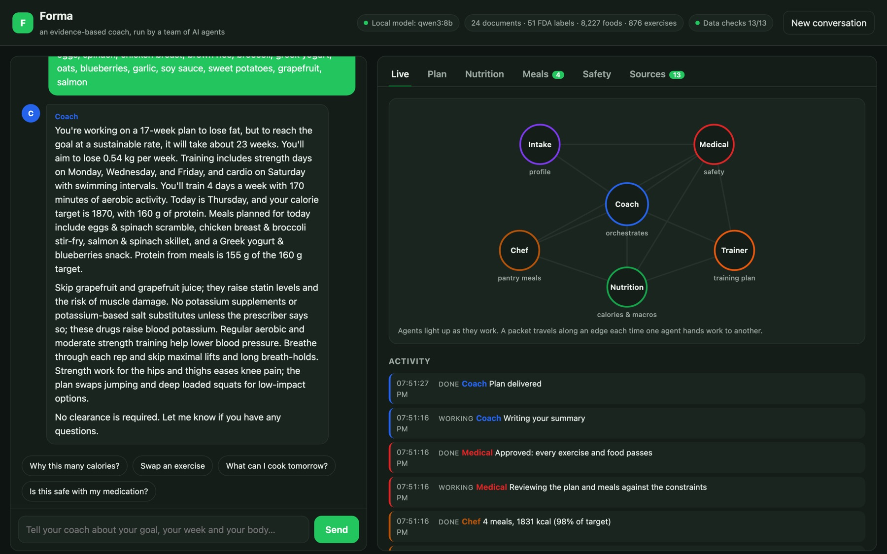
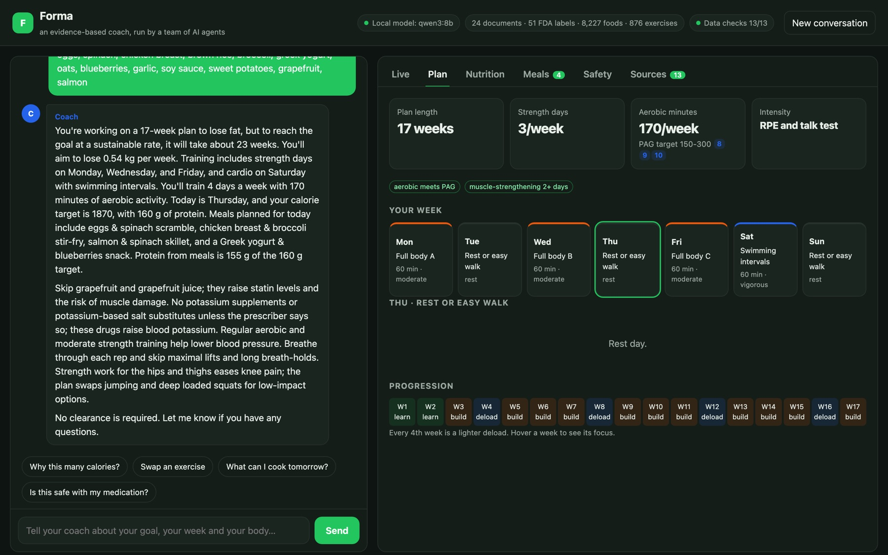
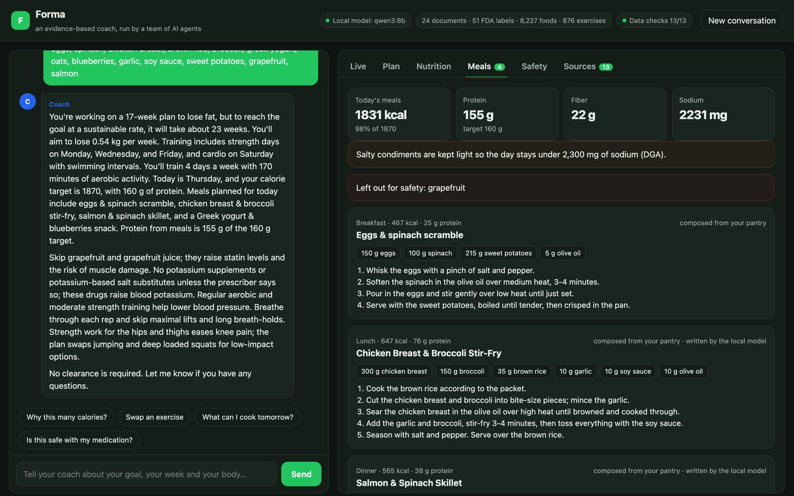
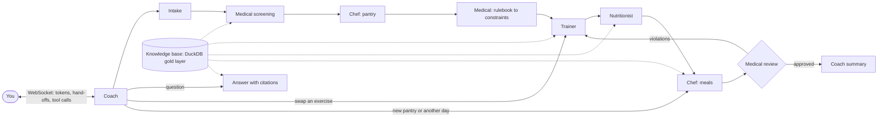

# Forma

**A team of AI agents that works like a certified personal trainer, a dietitian and a pharmacist-minded safety reviewer, grounded in a data pipeline over public health guidelines, FDA drug labels, USDA food data and open-access research.**

Tell it your goal, your timeline, the training you can do and how often. It asks about your medical history and medications, checks every exercise and food against them, sets a sustainable rate of change and a calorie target for each day, and turns what is in your fridge into meals with recipes. A live dashboard shows the agents working and handing off to each other as you talk.

Everything runs locally and for free: a local model through [Ollama](https://ollama.com) (`qwen3:8b`), DuckDB, and an ONNX embedding model on the CPU.



<p> </p>

## What the agents do

| Agent | Job | How it decides |
|---|---|---|
| **Coach** | Routes each message, writes the summary, answers questions | Routing rules; answers retrieve 5 passages by vector search and cite them as `[n]` |
| **Intake** | Reads age, sex, height, weight, goal, timeline, days, minutes, equipment, experience, diet and allergies from free text | Rules first (units, ft/in, lbs, "3x/week", "35M"); the LLM fills only categorical fields the rules missed |
| **Medical** | Screens conditions, medications (brand or generic) and symptoms; sets the constraints; reviews the final plan and meals | A 34-rule rulebook. Each rule's effect is backed by a verbatim passage from an FDA label or guideline, checked at build time |
| **Trainer** | A periodized plan: full-body, upper/lower or split templates by frequency, a deload every 4th week, RPE and talk-test intensity | Exercise library of 876 movements tagged by pattern and risk (spinal load, impact, plyometric, deep knee flexion and more). PAG: 150+ aerobic minutes and 2+ strength days |
| **Nutritionist** | Calories and macros for each weekday | Mifflin-St Jeor BMR × lifestyle + MET-based session energy. Loss capped at 0.5-1% of body weight a week (ISSN), deficit at most 25%, never below BMR or 1,200/1,500 kcal. Protein 1.6-2.0 g/kg, fat ≥25% of energy, saturated fat under 10% (DGA) |
| **Chef** | A day of meals from your pantry, sized to the targets, with recipes | A recipe from the corpus your pantry covers, or one composed by role (protein, starch, vegetable, fat, flavour). Every number comes from USDA data for the exact grams; protein is topped up by trading starch for the meal's lean protein, and salty condiments are trimmed to keep the day under 2,300 mg of sodium (DGA). The LLM writes titles and steps, and a guard rejects any step that adds an ingredient or a blocked food |

The Medical agent can send the plan back: if a review finds an exercise or food that breaks a constraint, the Trainer and Chef rebuild without it (up to two rounds). It never diagnoses and never suggests changing a medication; when a rule calls for it, it says to see a clinician first and keeps the plan at light or moderate intensity until then.



## The data pipeline

The agents never read the web. They read a warehouse built by `forma pipeline`, the same layered pattern as a production data platform:

| Layer | What happens |
|---|---|
| **Bronze** | Downloads every source in [`sources.yaml`](sources.yaml) with retries, records URL, license, SHA-256 and time. A license allowlist (public domain, CC BY, CC0, Unlicense, API terms) rejects anything else; Europe PMC's own license field must agree with the manifest |
| **Silver** | Parses PDFs page by page, JATS XML papers by section and HTML fact sheets, skipping references and front matter. Loads USDA FoodData Central CSVs with DuckDB, the exercise JSON, openFDA label sections and recipes |
| **Gold** | Foods with 16 nutrients, portion weights and safety tags (allergens, grapefruit, tyramine, calcium-rich and so on); exercises tagged by movement pattern and risk; 5,959 passages embedded with `bge-small-en-v1.5`; the rulebook with its evidence; recipes resolved to USDA foods and grams |
| **Ops** | Each run's steps and timings, the 13 quality checks, and an embedding cache so rebuilds take seconds |

The build fails unless all 13 checks pass. They cover: every source downloaded and allowlisted; every document parsed; USDA foods loaded and every screened medication labelled; food energy agreeing with macronutrients (99.0% within 20%); no negative nutrients; every ingredient alias resolving; plant foods reporting fiber; the exercise library usable; every passage embedded and normalized; every rule backed by a verbatim source passage; and enough recipes resolved to nutrition. The fiber check exists because of a real bug: USDA Foundation records for berries omit fiber, which counted as zero until the pipeline started borrowing missing nutrients from the SR Legacy record of the same food.

Latest build: 29 sources (172 files), 24 documents in 643 sections, 8,227 foods with 665,551 nutrient values, 876 exercises, 51 FDA labels across 26 drug classes, 362 of 790 recipes usable, 34 rules with 44 evidence passages, 13 of 13 checks passed, 42 s warm.

### Sources and licenses

| Source | What it grounds | License |
|---|---|---|
| [Dietary Guidelines for Americans 2025-2030](https://www.dietaryguidelines.gov/) (USDA, HHS) | Saturated fat, food groups | Public domain |
| [Physical Activity Guidelines for Americans, 2nd ed.](https://odphp.health.gov/our-work/nutrition-physical-activity/physical-activity-guidelines) (HHS) | Weekly minutes, strength days, older adults, pregnancy, chronic conditions | Public domain |
| NIH Office of Dietary Supplements fact sheets: vitamin K, potassium, B12, calcium, vitamin D | Drug-nutrient interactions | Public domain |
| FDA drug labels via [openFDA](https://open.fda.gov/), 51 generics in 26 classes | Medication rules (statins and grapefruit, MAOIs and tyramine, insulin and exercise, fluoroquinolones and tendons...) | Public domain |
| 17 open-access papers via Europe PMC: ISSN position stands (protein, weight loss, diets, timing, meal frequency, caffeine, creatine, omega-3), resistance-training trials and reviews, exercise in hypertension, diabetes, knee osteoarthritis and sarcopenia | Rates of loss, protein, programming | CC BY |
| [USDA FoodData Central](https://fdc.nal.usda.gov/): Foundation Foods (2026-04) and SR Legacy | Every calorie and nutrient number | Public domain |
| [free-exercise-db](https://github.com/yuhonas/free-exercise-db) | The exercise library | Unlicense |
| [TheMealDB](https://www.themealdb.com/) | Recipe ideas (fetched at build time, not redistributed) | API terms |

Copyrighted textbooks are deliberately excluded: the rulebook cites only sources whose text can be quoted.

## Evaluation

`forma eval` runs 29 personas through the whole agent graph, three messages each: goal and body, medical history, pantry. Each persona carries the answers a trainer and a pharmacist would give: which rules apply, whether a clinician must clear the person, and which exercise and food tags must never appear. The system is checked against those answers, not against its own reviewer:

| Check | What passes | LLM off |
|---|---|---|
| Profile extraction | Every expected field read correctly | 29/29 |
| Medical extraction | Exactly the expected conditions and medications | 29/29 |
| Rules | Exactly the expected rules applied (precision and recall) | 29/29 |
| Clearance | Clinician clearance decision matches | 29/29 |
| Plan safety | No exercise with an avoided tag; intensity within the limit | 29/29 |
| Meal safety | No ingredient with a blocked tag (medication, allergy, diet) | 29/29 |
| Energy | Never below the floor; deficit ≤ 25%; loss ≤ 1% of body weight a week; no deficit when contraindicated | 29/29 |
| Protein | 1.2-2.2 g/kg, or ≤ 0.8 g/kg with kidney disease | 29/29 |
| Activity | 150+ aerobic minutes and 2+ strength days (unless clearance comes first) | 27/27 |
| Citations | Every applied rule carries a verbatim source passage | 29/29 |
| Meals fit | The day's meals within 85-110% of the calorie target | 29/29 |
| Sodium | The day's meals under 2,300 mg (DGA) | 29/29 |
| Retrieval | The expected source in the top 5 for 18 evidence questions | 18/18 |

The run fails unless the safety checks pass 100% and the rest at least 90%. Personas cover levothyroxine, statins with grapefruit in the pantry, warfarin, MAOIs with aged cheese, metformin and insulin, pregnancy, chest pain on exertion, eating-disorder history, kidney disease, osteoporosis, ciprofloxacin, beta-blockers, SGLT2 inhibitors, GLP-1s, diuretics, doxycycline, peanut allergy, vegan and vegetarian diets, and a crash-diet goal.

**How honest is 29/29?** 21 personas were written first and the system was tuned against them, so their score says little about new phrasings. The other 8 (`HELD_OUT` in [`evaluate.py`](src/forma/evaluate.py)) were written afterwards in other people's phrasing ("35M, 6ft 1, 210 lbs", "Female, 42", "3 times weekly", "on atenolol for blood pressure", "lactose intolerant"). On their first run, **3 of 8 passed fully**: five stalled at intake because the rules missed those age, frequency and condition phrasings, and the agent kept asking. Every persona that reached a plan passed every safety check. The misses were fixed, and the runner persona exposed a real gap (no strength work for a runner) that changed the planner. Expect new phrasings to fail the same way, safely: the agent asks again rather than guessing.

With the local model on (`forma eval --llm ollama:qwen3:8b`, on an Apple-silicon Mac), all 29 personas still pass every check: the model fills categorical fields, writes recipe steps and summaries, and cannot change a number or a safety decision. A whole persona (three messages, including the streamed summary and four recipes) takes 27 s on average (21-32 s); with the model off it takes 0.14 s. CI runs with the model off, so its gates are deterministic.

The eval found real bugs before they shipped: "4 days a week" was read as a one-week timeline, which failed validation and blocked intake; "get stronger" and "stay fit" goals were missed; the planner ignored a light-only limit for someone awaiting clearance, and put full-body sessions on back-to-back days; the per-meal medication timing flagged 10 g of garlic as calcium-rich; and once a sodium check was added (after the dashboard showed 2,506 mg for someone with high blood pressure), it caught the protein top-up mistaking soy sauce for a lean protein and serving 115 g of it, 7,900 mg of sodium in one day.

26 pytest tests cover the parsers, food tags, energy targets, the planner, the rulebook, a full conversation through the graph, the chef and the WebSocket API.

## Run it

Needs Python 3.12. The LLM is optional: without Ollama, Forma runs rules-only and still produces the same plan, targets and meals (summaries and recipe steps fall back to templates).

```bash
git clone https://github.com/Manvith-d/forma && cd forma
python -m venv .venv && source .venv/bin/activate
pip install -e ".[dev]"
forma pipeline        # downloads ~140 MB of public data and builds the warehouse (first run ~5 min on 4 cores, then ~40 s)
ollama pull qwen3:8b  # optional
forma serve           # http://localhost:8000
```

`forma eval` runs the evaluation (add `--llm ollama:qwen3:8b` to include the model), and `pytest` runs the tests. Settings come from the environment: `FORMA_LLM` (`ollama:<model>` or `none`), `OLLAMA_HOST`, `FORMA_DATA`, `FORMA_HOME`.

With Docker, `docker compose up --build` builds the warehouse into the image and talks to Ollama on your machine; `docker compose --profile ollama up --build` runs Ollama in a container too.

CI (GitHub Actions) builds the pipeline with its checks, lints, runs the tests and the eval gates with the LLM off, and builds and smoke-tests the Docker image.

## Layout

```
sources.yaml            every source, its license and how to fetch it
knowledge/rules.yaml    the rulebook: effects plus the verbatim evidence each must match
src/forma/pipeline/     bronze, silver, gold, quality checks, run records
src/forma/kb.py         the agents' read-only view of the warehouse, with vector search
src/forma/agents.py     the LangGraph team, its events and sessions
src/forma/{safety,planner,nutrition,chef}.py   the deterministic engines behind each agent
src/forma/understand.py turning free text into a profile and a medical history
src/forma/evaluate.py   personas and gates
web/                    the dashboard (no build step)
```

## Limitations

- Not medical advice and not a substitute for a clinician, dietitian or pharmacist. The rulebook covers 51 common medications and a set of conditions; anything else is flagged for a professional rather than judged.
- Extraction is rules-first. It handles common phrasings, and the held-out result above shows the failure mode when it does not.
- Food matching uses USDA names; unusual products may match a generic food or none (unmatched items are shown). Raw weights are used for meat and grains.
- The local 8B model writes prose only. It can still word a summary awkwardly, but it does not set any number.
- Sessions are JSON files and there is no authentication: Forma is a single-user local app.

MIT license. Built by [Manvith Reddy Dalli](https://manvith-d.github.io/portfolio/).
